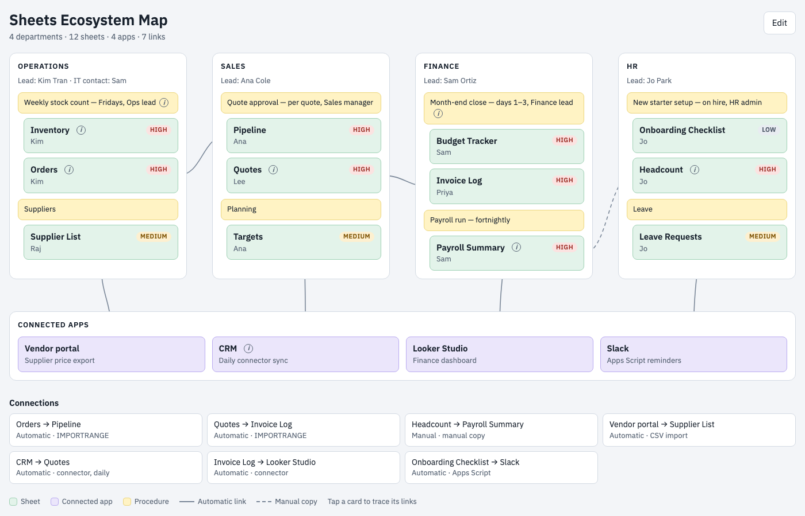

# Sheets Ecosystem Map

A map of departments, Google Sheets, connected apps and the links between them. The map is drawn from a plain Markdown file.

## Run locally

Double-click `start.command` (macOS), or in a terminal in this folder:

    python3 server.py

Then open:

- http://localhost:8000/ for your map (`maps/work.md`)
- http://localhost:8000/?map=demo.md for the example data (`maps/demo.md`)

`maps/work.md` is private and not tracked by git. Create your own copy (for example from `maps/demo.md`) and edit it. Without it the page shows the built-in demo.

Opening `index.html` directly also works, but it can only show the built-in demo. Browsers block reading `maps/*.md` from a file path.

## Edit

1. Edit `maps/work.md` in any text editor, then refresh the page. Or tap Edit in the page and change the text there.
2. In the page, press Save (or Cmd/Ctrl+S in the editor). It writes straight to `maps/work.md` and keeps the previous version as `maps/work.md.bak`. This needs `server.py`, which `start.command` runs.
3. Download .md is still there if you want a separate copy.

## Markdown format

    # Map title

    ## Department name
    Lead: free text line (optional)
    > Section title (yellow card, repeat as needed)
      Optional note, indented two spaces
    - Sheet name | owner | high | https://link     (criticality: high, medium or low; link optional)
      Optional note, indented two spaces
    - Another sheet | owner | medium
    > Next section
    - Sheet in the next section | owner | low

    ## Apps
    - App name | what it does
      Optional note

    ## Links
    - Sheet A -> Sheet B | IMPORTRANGE
    - Sheet C -> Sheet D | manual copy               (a note containing "manual" is drawn dashed)

- A `>` line starts a section. The `-` lines under it belong to that section. A department can have as many sections as you like.
- An indented line under a section or an item is its note. Tap the card on the map to open a note card with the note, the owner, the sheet link and what it sends to or receives from. Cards with a note show a small "i".
- Names in Links must match a sheet or app name exactly (capitals ignored). A mismatch shows a warning under the map.

## Tickets

The Tickets tab shows tickets and projects as a Kanban board (To do, In progress, Blocked, Done) or as a table. Switch with Board / Table; the choice is remembered. Each ticket can be linked to a sheet, a connected app or a whole department, and is drawn as a chip in the map's colours (green sheet, purple app, yellow department).

- A summary at the top shows how many tickets are in each status, and one red line per blocked ticket. Click that line to open the ticket.
- Press New ticket to add one. Click a card or row to edit it in the drawer beside the list. Set the status with the buttons in the drawer; Blocked asks what it is waiting on, and that text shows on the card.
- Board: drag a card to another column to move it.
- Table: grouped by department, with the status changeable in place from the dropdown in each row.
- Time: open a ticket and use "Time spent" to log hours (for example 1.5) with an optional note. Each entry is dated and can be removed. The total shows on the card and in the table's Time column.
- Filter by type, owner, open only, or search the text.
- On the Map tab, linked cards and departments show a small badge with the number of open tickets. Tap a card to see its tickets and jump to them.
- To create a ticket from the map, tap a sheet or app, type a title in "Add a ticket to ..." and press Add. It is saved as a To do ticket linked to that card. Press More... to add the owner, link and notes in the Tickets tab first.
- A ticket linked to something that is no longer on the map shows "unlinked" and a warning under the map.
- Tickets are saved to `maps/<map>.tickets.json` (for example `maps/work.tickets.json`), with the previous version kept as `.bak`. This needs `server.py`, which `start.command` runs.
- `maps/work.tickets.json` is private and not tracked by git. `maps/demo.tickets.json` is the example, shown with `?map=demo.md`.

## Files

- `index.html`: the whole app (parser, layout, editor). No build step, no dependencies. Fonts load from Google Fonts when online and fall back to system fonts.
- `maps/demo.md`: example data.
- `maps/work.md`: your map. Start here.
- `maps/demo.tickets.json`: example tickets. `maps/work.tickets.json` holds your own.
- `server.py`: the local server. It serves the folder and accepts saves to `maps/*.md` and `maps/*.json` only, from this page only, on localhost only.
- `start.command`: runs `server.py` and opens the browser on macOS.
test commitlint
