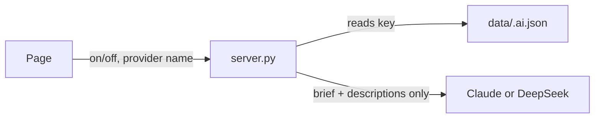

# Setting up AI

AI features (Generate flow, Ask AI) call a provider you choose: **Claude** or **DeepSeek**. Nothing is on by default.

1. Create `data/.ai.json` (the `data/` folder is gitignored, and files starting with a dot are never served to the page or listed as maps):

```json
{
  "provider": "claude",
  "apiKey": "paste your key here"
}
```

2. Use `"deepseek"` as the provider to call DeepSeek instead. Optional fields: `"model"` (defaults: `claude-sonnet-5-5`, `deepseek-flash`) and `"baseUrl"` (only for a proxy or a test stub).
3. Open **Business flows**, press **AI**, then **Test connection**.



## What leaves your computer

Only when you use an AI feature, and only to the one provider named in the file: the text you wrote (your brief and draft), the Department and Function descriptions that are relevant, the current flow (for edits) and the names of sheets and apps. Member emails, tickets, time logs and other maps are never sent. The panel shows this notice with the provider's name.

## Generate flow

On a Flow with no steps, write a brief (and, if you like, a rough draft of the steps) in **Describe your case**, then press **Generate flow**. The first time, a notice names the provider and asks you to confirm. The AI's answer is checked on the server (unknown sheets are kept as plain text and flagged, step references are validated, limits of 40 steps and 12 teams apply) and shown as a preview of the real diagram. Nothing changes until you press **Accept**; one **Undo** takes the whole flow back, and nothing is written to disk until you press **Save**.

## Limits

The brief and the draft are each limited to 8000 characters, so one request has a bounded cost. A missing or wrong key, a provider outage or an empty answer leaves your data untouched and shows a short reason.

## For developers

Tests never call a real provider: `scripts/lib/ai_stub.py` fakes both APIs. Run `python3 scripts/test_ai.py`, `python3 scripts/test_ai_flow.py`, `node scripts/e2e-ai-setup.mjs` and `node scripts/e2e-ai-generate.mjs`. DeepSeek's model name and base URL were checked against its docs (api-docs.deepseek.com) on 2026-11-24; thinking mode is turned off for these calls and has not been tried against the live service.
