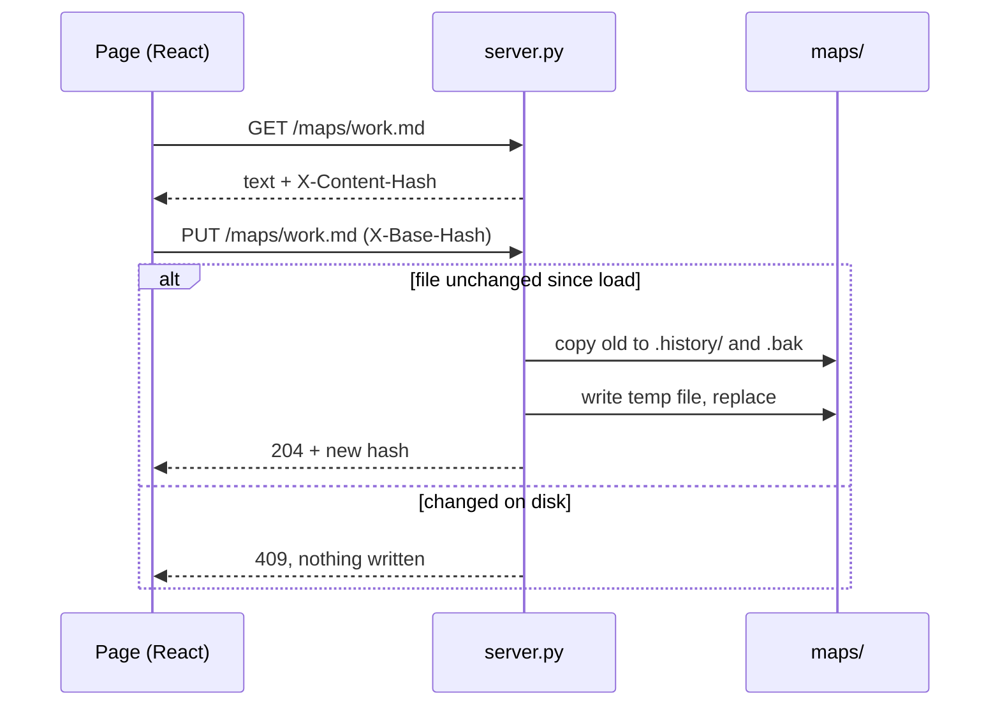

# Sheets map: React app design

**Goal.** Replace the hand-wired UI with a React app (Vite, Tailwind, React Flow) **without losing a single record**. The data stays in plain files in `maps/`; only the screen changes.

## Storage rules

The files are the database (see *Data file* in `GLOSSARY.md`). `server.py` is the only thing that writes, so every rule lives in one place and has tests.

| # | Rule | Where it is enforced |
|---|------|----------------------|
| 1 | Same formats: `.md`, `.flows.md`, `.tickets.json`. New fields are optional (e.g. an indented `Purpose:` line), so old files always load. | parsers in `app/src/lib/` |
| 2 | Every save first copies the old file to `maps/.history/<name>/` (last 20) and to `<name>.bak`. | `server.py`, `scripts/test_server.py` |
| 3 | A save carries the *base hash*. If the file changed on disk since it was loaded, the server answers 409 and writes nothing. The page then offers Reload or Overwrite (Overwrite still snapshots the other version). | same |
| 4 | Writes go to a temp file, then replace, so a crash never leaves half a file. | same |
| 5 | Explicit **Save** with an unsaved-changes dot and a leave-page warning. No autosave. | UI (to port) |
| 6 | If a file holds something the form cannot keep (a comment, an unreadable line: `mapLossy`), the form editor is blocked for that file; only the raw Markdown editor can save it. | UI (to port) |

## The gate: nothing is lost

`npm run verify` (read-only) must pass before any migration step:

1. The new ES-module parsers (`app/src/lib/`) give byte-identical results to the original `js/` parsers on **every** file in `maps/`, private ones included.
2. Every file round-trips parse → write with no data lost (the app's own `mapLossy` rule).
3. Tickets keep all fields: they are read and written as plain JSON, never reshaped.
4. `server.py` storage tests (history, 409, force, size and origin limits).

CI can only run it on the `demo.*` files; run it locally before each commit.

## Layout

`app/` Vite + React 19 + Tailwind v4 + React Flow. Left rail: Overview (canvas + layers), Journey, Catalog, Detail, Tickets & projects, Business flows. Dev: `cd app && npm run dev` (proxies `/maps` and `/api` to `server.py`). Build: `app/dist`.

## Migration order

1. **Done:** read-only app on the real records; storage hardening; verify gate.
2. Port the editors, each behind the gate: map form + Markdown, ticket form (log time, projects, change requests), flows editor, New map, Save/conflict UI (rules 5 and 6).
3. When parity is reached: serve `app/dist` at `/`, then delete the old `index.html`, `js/` and `css/`.
4. Never touched at any step: `maps/` and every `.bak`.

## Decided (storage format round)

See [ADR 0001](adr/0001-one-json-data-file-per-map.md). In short:

- One JSON Data file per map in `data/`; entries have permanent IDs (links point at IDs, names are labels); `schemaVersion` in every file.
- One-time, re-runnable import from the old files, which are never modified. `npm run verify` proves import → export-as-legacy-files matches every old file.
- Deleting moves an Entry to **Removed** (restorable until purged), on top of Snapshots.
- Off-disk **Backup** button to a folder you choose, with a reminder after 7 days.
- Exports (map document, ticket report, flow document with Mermaid) are buttons in the app that download `.md`.
- Build order: undo/redo + Removed, global search (`⌘K`), shared filters, export buttons.
- Switch-over: editors ported, `npm run verify` passes on real files, a week of normal use; then the old app and old files stay 30 more days; only the old UI code is deleted, never old data.

## Not decided yet

- Whether Catalog and Detail both stay in the rail (both stay for now).
- The "What it is for" field: stored as `Purpose:` (rule 1) once the map form is ported.
