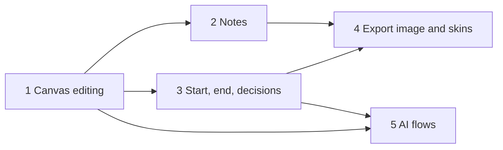

# Plan: Business flow canvas and AI flows

Status: Phases 1 and 2 built on branch `feat/flow-canvas-editing` (see their notes below); phases 3 to 5 not started. Scope is the React app (`app/`) only. The legacy vanilla app is frozen.

## Goal

Make Business flows simple to build, flexible to note, and clear as a diagram:

1. The canvas is the editor (drag, type on the diagram, draw arrows), like a drawing tool.
2. Notes are free text, with sticky notes anywhere.
3. The diagram explains the process: start/end, decisions with labelled branches, labelled hand-offs.
4. The diagram can be shared as PNG/SVG (Mermaid export stays).
5. The user writes descriptions per Department and Function, and AI generates and later edits the flow.

## Rules that apply to every phase

- **Additive only.** New fields are optional. Old flows and `data/*.json` load unchanged. Bump `schemaVersion` only if `upgrade()` cannot fill the gap in memory.
- **The data file changes only on Save**, after a snapshot. Never overwrite `data/*.json`.
- **Every canvas action goes through `apply` / undo / redo.** Deletes go to **Removed** and restore exactly. New entries get a permanent `sort`.
- **Shared language** follows `GLOSSARY.md` (Team, Hand-off, Function, Entry, Data file). Add **Note**, **Decision** and **Brief** to it when they land.
- Tests: extend the existing round-trip and 2000-sequence delete/restore tests to cover each new field.

## Facts the plan rests on

- Flow canvas today: `src/views/Flows.jsx` + `buildFlow` in `src/graph.js`. Steps are `draggable: false`; positions come from dependency depth. Editing is the 400px form `components/FlowEdit.jsx`.
- Flow data (`lib/schema.js`): `flows[{ id, title, every, teams, steps[{ id, team, title, day, sheetId|sheetName, ticket, note, triggers, backs }] }]`. Ops in `lib/ops.js`: `addFlow`, `updateFlow`, `addStep`, `updateStep`, `shiftStep`, `removeStep`.
- Department description is `text[]`; Function description is `section.note`. These are the AI input.
- There is no AI in the app. `server.py` only reads and writes `data/*.json`.

## Build order

## Phase 1: Edit on the canvas

- Double-click a step to type its text inline. Delete removes it (to Removed).
- Drag a step to another lane: sets `team`. Horizontal position stays automatic and snapped. Drag within a lane reorders (`shiftStep`).
- Draw an arrow by dragging from a step's right handle to another step: adds a `trigger` (later step) or a `back` (earlier step). Select an arrow to change its message or delete it.
- Double-click an empty lane spot to make a step in that team. Enter after typing makes the next step, already triggered by the previous one. Esc stops.
- Paste several lines to make several steps; the team defaults to the previous step's team.
- Rename, reorder and add lanes directly on the canvas.
- The side form shrinks to a details panel (day, sheet, ticket, note) that opens on select.
- Done when: a whole flow can be built and rearranged without opening the form, and every action undoes.
- **Built (phase 1):** inline retype, drag between lanes (hot-lane highlight), draw arrows by dropping anywhere on the target step, Delete for steps and arrows, double-click-to-add with Enter chaining, multi-line paste, lane add/rename/reorder/remove, details panel for the selected step only. Tests: `scripts/test-flow-edit.mjs`, `scripts/e2e-flow-canvas.mjs`.
- **Not done, on purpose:** dragging a step sideways within its lane does not reorder it. A step's column comes from its arrows, and reordering by hand would silently break "waits on an earlier step". Reorder still uses the details panel's up/down. Decide with the user whether to add this.
- **Found on the way:** every canvas in the app turns black on a dark-mode OS (React Flow follows the system theme while the rest of the app is light-only). Not caused by this work; the Blueprint skin in Phase 4 is the place to settle it.

## Phase 2: Notes

- Add optional `note` to the flow (the existing step `note` stays).
- New **Note** Entry: `{ id, sort, text, x, y, attachedStepId? }` stored on the flow (`flow.notes`). Free-floating or attached to a step with a thin line. Double-click to edit. Delete goes to Removed.
- Notes are drawn on the diagram and exported to Markdown/Mermaid as comments.
- Done when: notes survive Save, reload, undo, Removed/restore, and legacy round-trip.
- **Built (phase 2):** `flow.note` (shown above the diagram, edited in the details panel) and `flow.notes[{ id, sort, text, x, y, stepId? }]`. A pinned note's x,y are an offset from its step, so it follows the step; a free note's are canvas coordinates. Add from a step's "+ Note", the header "+ Note" button, or by double-clicking empty canvas. Double-click edits (Ctrl/Cmd+Enter or leaving the box saves, Esc drops the change), drag moves, Delete sends it to Removed, and a note typed but left empty is never created. If a pinned note's step is deleted the note stays (drawn dashed) and re-pins when the step is restored. The Markdown legacy export is unchanged; the "new fields" export writes notes as `<!-- Note: ... -->` comments the old parser skips. Tests: `scripts/test-flow-notes.mjs`, `scripts/e2e-flow-notes.mjs`.
- **Not done:** Mermaid export of notes, because the Mermaid flow export does not exist yet (Phase 4). Un-pinning or re-pinning an existing note is not possible; delete and re-add.

## Phase 3: Start, end and decisions

- Optional step `kind`: `step` (default) | `start` | `end` | `decision`. A decision draws as a diamond; its outgoing arrows use the existing trigger message as the branch label (Yes/No). The existing send-back arrows stay dashed red.
- Start/end draw as pills. A flow with no start/end looks exactly as today.
- Update `flows-parser.js` / export only where needed so the Markdown and Mermaid exports show the new kinds, and the legacy import still works.
- Done when: the Quote approval demo can be redrawn with a start, a decision and an end, and old flows are unchanged.

## Phase 4: Export image

- Export the swimlane as SVG and PNG (client side, from the rendered diagram, including notes). Mermaid `.md` export stays.
- Skins (Paper light, Blueprint dark, Marker sketch) are a styling layer only: tokens for colour, line weight, corner radius and step font. Paper and Blueprint follow the app's light/dark mode; Marker is optional. Concept screens (open in a browser): `docs/flow-concepts/flow-canvas-skins.html`.
- Done when: an exported image matches the on-screen diagram in the chosen skin.

## Phase 5: AI flows

Builds on Phase 1 (preview highlighting) and Phase 3 (decision kinds).

**Input.** Department `text`, Function `note`, and a new optional flow `brief` (free text). Nothing else is required.

**Server.** Add to `server.py`:
- `POST /api/ai/flow` with `{ mapId, flowId?, brief?, instruction? }`.
- The Claude API key and model are read from a local gitignored file (for example `data/.ai.json`: `{ "apiKey", "model" }`; default model `claude-sonnet-5-5`). The key is never sent to the browser or logged.
- `GET /api/ai/status` tells the browser only whether AI is configured.

**What is sent.** The relevant Department descriptions, Function descriptions, the current flow (for edits), and the names of sheets and apps on the map (for matching). Not sent: member emails, tickets, time logs, other maps.

**What comes back.** A flow in the existing flow shape, validated against `schema.js` before the browser sees it. Invalid output means an error message and no change.

**Sheet matching.** Step sheets are matched by name to real sheets. An unknown name is kept as `sheetName` and flagged with the existing warning. The AI never creates sheets.

**UI.**
- "Generate flow" on a new or empty flow, using the descriptions and the brief.
- "Ask AI" box on a flow: type a change ("add a QA check before Finance"), the AI returns the edited flow.
- **Preview before apply:** new steps highlighted, removed ones struck through, changed text marked. Accept applies through the normal `apply`/undo path; Discard drops it. Nothing is saved until the user presses Save.
- No key set: buttons disabled with a short hint. API failure: flow untouched, reason shown.

Done when: a map with written descriptions produces a valid flow, an "Ask AI" edit previews and applies with undo, and a missing key or a bad response leaves the data untouched.

## Open items

- Exact `kind` and `notes` field names, to settle when Phase 2 and 3 start (they live in `schema.js` and `upgrade()`).
- Whether Marker ships in the first release or later.
- A cap on AI cost per request, if it matters in use.
